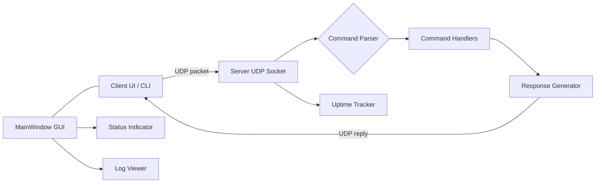
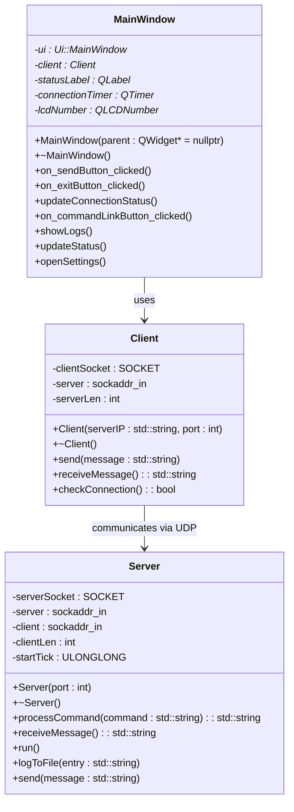

# QtUDPServerClient
[](https://git.io/typing-svg)

---

## Description
A professional Qt‑based C++ application implementing a lightweight **UDP client–server** system with a command‑driven protocol and a graphical interface. The project demonstrates Winsock2 socket programming, robust command handling, connection monitoring, uptime tracking, and persistent logging through a user‑friendly Qt GUI.

---

## Features and Commands

| **Feature** | **Details** |
|---|---|
| **Protocol** | Text command protocol over UDP |
| **GUI** | Qt Widgets: status indicator, request counter, live log view, status bar |
| **Logging** | Append‑mode `server.log` with timestamps |
| **Uptime** | Tracked using `GetTickCount64()` |
| **Error handling** | Exceptions via `std::runtime_error` |
| **Platform** | Windows (Winsock2) |

| **Command** | **Description** | **Example response** |
|---|---|---|
| `/ping` | Health check | `pong` |
| `/send <msg>` | Echo message back | `Server received: Hello` |
| `/time` | Current server time | `Current time: 14:05:09` |
| `/date` | Current server date | `Current date: 10-08-2026` |
| `/datetime` | Date and time combined | `Current datetime: 10-08-2026 14:05:09` |
| `/uptime` | Server uptime in seconds | `Server uptime: 123 seconds` |
| `/ip` | Client IP address | `Client IP address: 192.168.1.10` |
| `/exit` | Close server session | `Goodbye!` |

---

## Project Structure

| **File / Folder** | **Purpose** |
|---|---|
| `Server.h` `Server.cpp` | UDP server and command handling |
| `Client.h` `Client.cpp` | UDP client implementation |
| `MainWindow.h` `MainWindow.cpp` | Qt GUI and interaction logic |
| `main.cpp` | Application entry point |
| `server.log` | Runtime log file (created at runtime) |
| `.gitignore` | Qt‑generated ignore rules for build artifacts |

---

## Build and Run

**Prerequisites**
- **Windows 10+**, **Qt 6**, **Qt Creator**, **MSVC toolchain**, **Git**

**Clone**
```bash
git clone https://github.com/USERNAME/QtUDPServerClient.git
cd QtUDPServerClient

### Open in Qt Creator
Open the project file (`.pro`) or `CMakeLists.txt` in **Qt Creator**, select a suitable kit (Qt version + compiler), configure the build, then **Build** and **Run** from the IDE.

---

### CMake (command line)
```bash
mkdir build
cd build
cmake .. -G "NMake Makefiles" -DCMAKE_BUILD_TYPE=Release
cmake --build .

```
## Run order
1. **Start the Server** executable first — the server binds to the configured UDP port.  
2. **Start the Client** executable or launch the GUI to send commands.
   
---

## Usage Examples

**Ping**
```text
/ping
# server response: pong
```
### Echo
```text
/send Hello server
# server response: Server received: Hello server
```
### Uptime
```text
/uptime
# server response: Server uptime: 123 seconds
```
### IP
```text
/ip
# server response: Client IP address: 192.168.1.10:54321
```

## Log entry format
All processed commands are appended to server.log in append mode. Each entry includes a timestamp, client address, received command and the produced response.

```text
[2026-08-10 13:45:02] 192.168.1.10:54321 Processed: /ping -> pong
[2026-08-10 13:46:10] 192.168.1.10:54321 Processed: /send Hello server -> Server received: Hello server
[2026-08-10 13:47:05] 127.0.0.1:60000 Processed: /uptime -> Server uptime: 123 seconds
```

## Screenshots


## Architecture and component diagram



## Class diagram


## Troubleshooting

### 🔒 Server fails to bind
- Check if the UDP port is already in use (`netstat -ano`).
- Ensure firewall/antivirus rules allow binding and receiving packets.
- If binding to a privileged port (<1024), run the application with administrator rights.

---

### 📡 No response from server
- Verify that client and server use the same port and IP (`127.0.0.1` for local testing).
- Confirm the server process is running and listening.
- Use a packet sniffer (e.g., Wireshark) to check if packets reach the host.

---

### 📝 GUI shows stale logs
- Ensure `server.log` is writable and opened in append mode.
- Restart the GUI or refresh the log view.
- Consider implementing a file watcher for automatic log updates.

---

### 🌐 Intermittent packet loss
- UDP is connectionless and unreliable by design.
- Add acknowledgements and retry logic at the application layer.
- For guaranteed delivery, switch to TCP.

---

### ⚙️ Build errors in Qt Creator
- Confirm the selected kit matches your installed Qt version and MSVC compiler.
- Clean the build directory and re-run qmake/CMake configuration.
- Check include paths and library links for Winsock2 and Qt modules.

---

### 🛡️ Permission or antivirus issues
- Temporarily disable or configure antivirus/firewall to allow UDP traffic.
- Add the application to the list of allowed programs.

## ❓ FAQ

### Why UDP instead of TCP?
UDP is lightweight, connectionless, and fast. It’s ideal for simple command protocols where low latency is more important than guaranteed delivery. TCP could be used for reliability, but it adds overhead.

---

### How do I handle packet loss?
Since UDP does not guarantee delivery, you can implement:
- Application‑level acknowledgements and retries.
- Sequence numbers to detect missing packets.
- Or switch to TCP if reliability is critical.

---

### Can this run on Linux?
The current implementation uses **Winsock2**, which is Windows‑specific. To run on Linux, you would need to replace Winsock calls with **POSIX sockets** and adjust the build system accordingly.

---

### How is uptime tracked?
The server uses `GetTickCount64()` to measure elapsed time since startup. This is simple and efficient for tracking uptime in seconds.

---

### Where are logs stored?
All processed commands are appended to `server.log` in append mode. Each entry includes a timestamp, client address, the received command, and the generated response.

---

### Can I extend the command set?
Yes. New commands can be added by extending the `processCommand` method in `Server`. Each command should return a string response that the client can display.

---

### Is encryption supported?
Currently, communication is plain UDP. For secure communication, you could:
- Add TLS over UDP (DTLS).
- Or switch to TCP with SSL/TLS.

---

### How do I test the client–server interaction?
- Run the server locally (`127.0.0.1`).
- Start the client and send commands like `/ping` or `/send Hello`.
- Use Wireshark to inspect UDP packets for debugging.


## Contact
For questions, bug reports, or collaboration:

- Open an issue on GitHub.

- Submit a Pull Request with your proposed changes and testing notes.

- Include logs and reproduction steps when reporting bugs.


## License
This project is licensed under the MIT License. Add a LICENSE file to the repository containing the full MIT text. </br> </br>
[](LICENSE)
