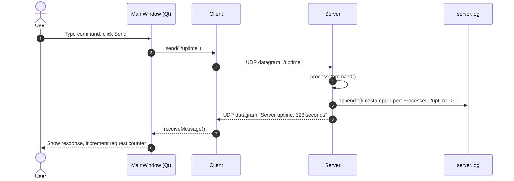
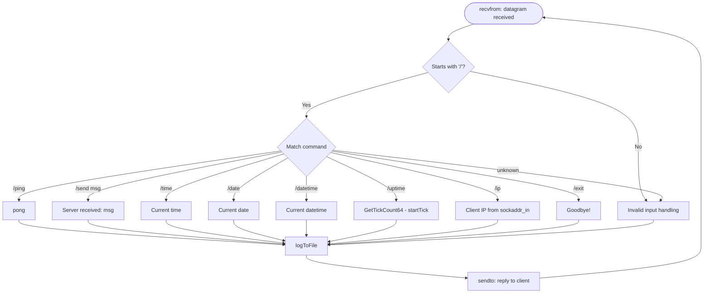
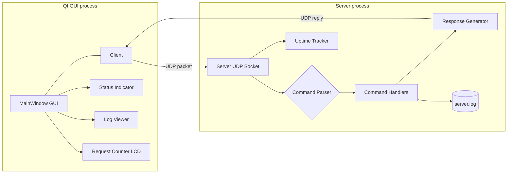
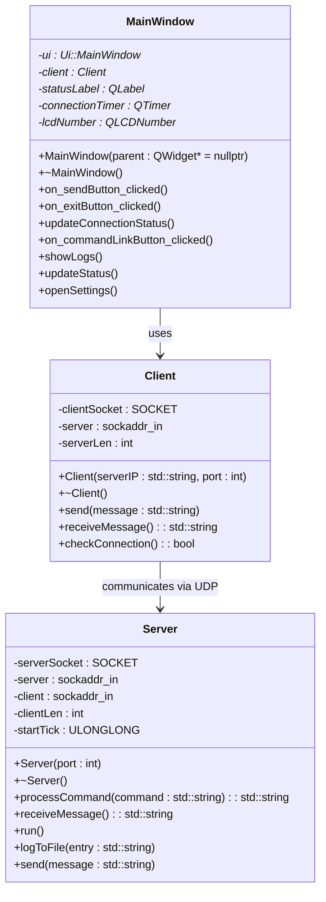
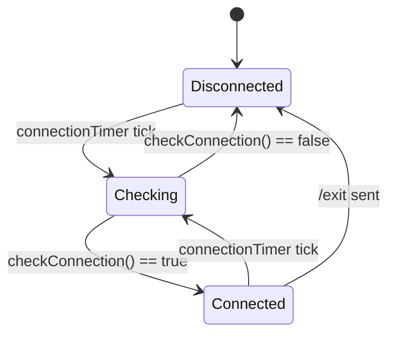
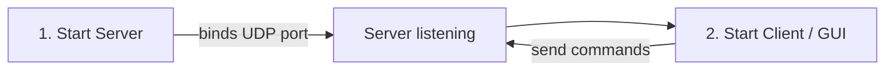
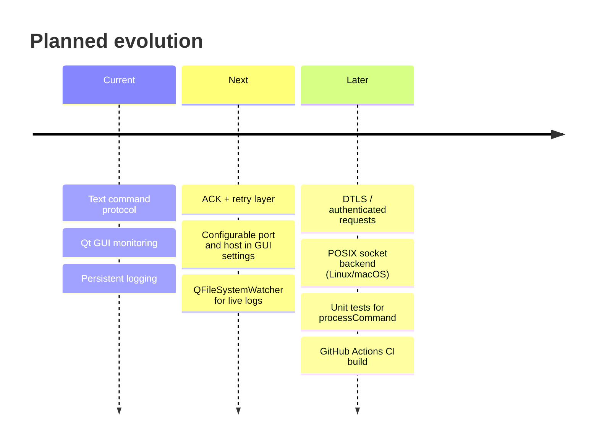

<div align="center">


[+%E2%86%92+listening...;%3E+%2Fping+%E2%86%92+pong;%3E+%2Fuptime+%E2%86%92+Server+uptime%3A+123+seconds;%3E+every+command+logged+to+server.log;%3E+Qt+6+%7C+C%2B%2B+%7C+Winsock2)](https://git.io/typing-svg)

<br/>


[](LICENSE)


**[Overview](#-overview) · [Features](#-features) · [Protocol](#-protocol-specification) · [Architecture](#-architecture) · [Build](#-build-and-run) · [Usage](#-usage-examples) · [Troubleshooting](#-troubleshooting) · [FAQ](#-faq) · [Roadmap](#-roadmap)**

</div>

---

## 📖 Overview

**QtUDPServerClient** is a compact, engineering-oriented **UDP client–server system** written in **C++ with Qt 6 and Winsock2**. A text-based **command protocol** runs on top of UDP datagrams, while a **Qt Widgets GUI** provides real-time connection monitoring, a request counter, a live log view and a status indicator.

The project is intentionally small so that every layer can be read and understood in one sitting:

| Layer | Responsibility |
|---|---|
| **Transport** | Raw UDP sockets via Winsock2 (`socket`, `bind`, `sendto`, `recvfrom`) |
| **Protocol** | Plain-text commands, one command per datagram, one response per command |
| **Application** | Command parser and handlers inside `Server::processCommand` |
| **Presentation** | Qt Widgets GUI with timer-driven connection checks |
| **Persistence** | Timestamped append-mode `server.log` |

> **Why this project exists:** to demonstrate low-level socket programming, a clean separation between networking and UI code, defensive error handling, and observability (logs + live status) in a minimal, dependency-light codebase.

---

## ✨ Features

| **Feature** | **Details** |
|---|---|
| 🔌 **Protocol** | Text command protocol over UDP |
| 🖥️ **GUI** | Qt Widgets: status indicator, request counter, live log view, status bar |
| 📝 **Logging** | Append-mode `server.log` with timestamps and client address |
| ⏱️ **Uptime** | Tracked using `GetTickCount64()` (monotonic, immune to wall-clock changes) |
| 🛡️ **Error handling** | Exceptions via `std::runtime_error`; RAII for socket lifetime (constructor / destructor) |
| 📡 **Connection monitoring** | `QTimer`-driven `checkConnection()` updates the status indicator |
| 🧩 **Extensible** | New commands are added in a single place: `Server::processCommand` |
| 🪟 **Platform** | Windows 10+ (Winsock2) |

### 🧾 Supported commands

| **Command** | **Description** | **Example response** |
|---|---|---|
| `/ping` | Health check | `pong` |
| `/send <msg>` | Echo message back | `Server received: Hello` |
| `/time` | Current server time | `Current time: 14:05:09` |
| `/date` | Current server date | `Current date: 10-08-2026` |
| `/datetime` | Date and time combined | `Current datetime: 10-08-2026 14:05:09` |
| `/uptime` | Server uptime in seconds | `Server uptime: 123 seconds` |
| `/ip` | Client IP address | `Client IP address: 192.168.1.10` |
| `/exit` | Close server session | `Goodbye!` |

---

## 📡 Protocol Specification

The protocol is deliberately minimal: **one datagram = one request**, **one datagram = one response**.

| Property | Value |
|---|---|
| Transport | UDP (connectionless, unreliable, unordered) |
| Encoding | Plain text |
| Request format | `/<command> [arguments]` |
| Framing | A single UDP datagram carries exactly one command |
| Direction | Client → Server (request), Server → Client (reply to the sender's address) |
| State | Stateless per request; server only keeps start time and the last client address |

### Sequence of a request



### Server request-handling flow



---

## 🏗️ Architecture

### Component diagram



### Class diagram



### GUI connection-state model



### Design decisions

| Decision | Rationale |
|---|---|
| **UDP instead of TCP** | Minimal overhead and latency; ideal for tiny request/response commands where occasional loss is acceptable |
| **Text protocol** | Human-readable, trivial to debug with Wireshark, easy to extend |
| **`GetTickCount64()` for uptime** | Monotonic and 64-bit, so no wrap-around after ~49 days and no sensitivity to system clock changes |
| **RAII sockets** | Socket created in the constructor and released in the destructor, so no leaks on exceptions |
| **Append-mode log** | Safe across restarts, simple to tail, trivially parseable |
| **Networking separated from UI** | `Client` and `Server` have no Qt UI dependency, so they can be reused or tested independently of `MainWindow` |
| **Timer-based status check** | Non-blocking connection monitoring without extra threads |

---

## 📂 Project Structure

```text
QtUDPServerClient/
├── Server.h / Server.cpp          # UDP server, command parsing, logging
├── Client.h / Client.cpp          # UDP client implementation
├── MainWindow.h / MainWindow.cpp  # Qt GUI and interaction logic
├── main.cpp                       # Application entry point
├── server.log                     # Runtime log (created at runtime)
└── .gitignore                     # Qt-generated ignore rules for build artifacts
```

| **File / Folder** | **Purpose** |
|---|---|
| `Server.h` `Server.cpp` | UDP server and command handling |
| `Client.h` `Client.cpp` | UDP client implementation |
| `MainWindow.h` `MainWindow.cpp` | Qt GUI and interaction logic |
| `main.cpp` | Application entry point |
| `server.log` | Runtime log file (created at runtime) |
| `.gitignore` | Qt-generated ignore rules for build artifacts |

---

## 🛠️ Build and Run

### Prerequisites

| Requirement | Notes |
|---|---|
| **Windows 10+** | Winsock2 is Windows-specific |
| **Qt 6** | Qt Widgets module |
| **Qt Creator** | Recommended IDE |
| **MSVC toolchain** | Visual Studio Build Tools or full Visual Studio |
| **Git** | To clone the repository |

### 1. Clone

```bash
git clone https://github.com/MIhajloS07/QtUDPServerClient.git
cd QtUDPServerClient
```

### 2a. Open in Qt Creator (recommended)

Open the project file (`.pro`) or `CMakeLists.txt` in **Qt Creator**, select a suitable kit (Qt version + MSVC compiler), configure the build, then **Build** and **Run** from the IDE.

### 2b. CMake (command line)

Run this from an **x64 Native Tools Command Prompt for VS** so that MSVC is on the `PATH`:

```bash
mkdir build
cd build
cmake .. -G "NMake Makefiles" -DCMAKE_BUILD_TYPE=Release
cmake --build .
```

> If CMake cannot find Qt, pass its location explicitly, for example `-DCMAKE_PREFIX_PATH="C:/Qt/6.x.x/msvc2022_64"`.

### 3. Run order



1. **Start the Server** executable first. The server binds to the configured UDP port.
2. **Start the Client** executable or launch the GUI to send commands.

---

## 💻 Usage Examples

**Ping**
```text
/ping
# server response: pong
```

**Echo**
```text
/send Hello server
# server response: Server received: Hello server
```

**Time, date and datetime**
```text
/time
# server response: Current time: 14:05:09

/date
# server response: Current date: 10-08-2026

/datetime
# server response: Current datetime: 10-08-2026 14:05:09
```

**Uptime**
```text
/uptime
# server response: Server uptime: 123 seconds
```

**IP**
```text
/ip
# server response: Client IP address: 192.168.1.10
```

**Exit**
```text
/exit
# server response: Goodbye!
```

---

## 📝 Logging

Every processed command is appended to `server.log` (append mode). Each entry contains a **timestamp**, the **client address**, the **received command** and the **produced response**.

```text
[2026-08-10 13:45:02] 192.168.1.10:54321 Processed: /ping -> pong
[2026-08-10 13:46:10] 192.168.1.10:54321 Processed: /send Hello server -> Server received: Hello server
[2026-08-10 13:47:05] 127.0.0.1:60000 Processed: /uptime -> Server uptime: 123 seconds
```

Format: `[yyyy-MM-dd HH:mm:ss] <client_ip>:<client_port> Processed: <command> -> <response>`

Quick inspection from PowerShell:

```powershell
Get-Content server.log -Wait -Tail 20
```

---

## 🖼️ Screenshots

<div align="center">


<br/><br/>


<br/><br/>


</div>

---

## ➕ Extending the Protocol

Adding a command takes one branch in `Server::processCommand`. Example: a hypothetical `/hostname` command.

```cpp
std::string Server::processCommand(std::string command)
{
    // ... existing commands ...

    if (command == "/hostname") {
        char name[256] = {};
        if (gethostname(name, sizeof(name)) == 0)
            return std::string("Server hostname: ") + name;
        return "Error: could not resolve hostname";
    }

    // ... fallback handling ...
}
```

Checklist for a new command:

- [ ] Add the handler branch in `processCommand`
- [ ] Return a single-line string response
- [ ] Add a row to the command table in this README
- [ ] Verify the entry appears in `server.log`

---

## 🔐 Security Considerations

This project is a learning and demonstration tool. Before exposing it beyond a trusted network, be aware that:

| Topic | Current state | Mitigation |
|---|---|---|
| **Encryption** | None, plain UDP | DTLS, or move to TCP with TLS |
| **Authentication** | None | Add a shared secret / HMAC token per datagram |
| **Spoofing** | UDP source addresses can be forged | Challenge–response handshake or signed requests |
| **Amplification / flooding** | Server replies to any sender | Rate limiting, keep replies smaller than requests |
| **Input validation** | Text input from the network is untrusted | Enforce maximum datagram length and strict parsing |

---

## 🧯 Troubleshooting

<details>
<summary><b>🔒 Server fails to bind</b></summary>

- Check if the UDP port is already in use (`netstat -ano | findstr UDP`).
- Ensure firewall or antivirus rules allow binding and receiving packets.
- If binding to a privileged port (below 1024), run the application with administrator rights.

</details>

<details>
<summary><b>📡 No response from server</b></summary>

- Verify that client and server use the same port and IP (`127.0.0.1` for local testing).
- Confirm the server process is running and listening.
- Use a packet sniffer (for example Wireshark) to check whether packets reach the host.

</details>

<details>
<summary><b>📝 GUI shows stale logs</b></summary>

- Ensure `server.log` is writable and opened in append mode.
- Restart the GUI or refresh the log view.
- Consider implementing a file watcher (`QFileSystemWatcher`) for automatic log updates.

</details>

<details>
<summary><b>🌐 Intermittent packet loss</b></summary>

- UDP is connectionless and unreliable by design.
- Add acknowledgements and retry logic at the application layer.
- For guaranteed delivery, switch to TCP.

</details>

<details>
<summary><b>⚙️ Build errors in Qt Creator</b></summary>

- Confirm the selected kit matches your installed Qt version and MSVC compiler.
- Clean the build directory and re-run the qmake/CMake configuration.
- Check include paths and library links for Winsock2 (`ws2_32.lib`) and Qt modules.

</details>

<details>
<summary><b>🛡️ Permission or antivirus issues</b></summary>

- Temporarily disable or configure antivirus/firewall to allow UDP traffic.
- Add the application to the list of allowed programs.

</details>

---

## ❓ FAQ

<details>
<summary><b>Why UDP instead of TCP?</b></summary>

UDP is lightweight, connectionless and fast. It is ideal for simple command protocols where low latency matters more than guaranteed delivery. TCP could be used for reliability, but it adds overhead.

</details>

<details>
<summary><b>How do I handle packet loss?</b></summary>

Since UDP does not guarantee delivery, you can implement:
- Application-level acknowledgements and retries.
- Sequence numbers to detect missing packets.
- Or switch to TCP if reliability is critical.

</details>

<details>
<summary><b>Can this run on Linux?</b></summary>

The current implementation uses **Winsock2**, which is Windows-specific. To run on Linux, replace the Winsock calls with **POSIX sockets** (and `GetTickCount64()` with `std::chrono::steady_clock`) and adjust the build system accordingly. The Qt GUI itself is cross-platform.

</details>

<details>
<summary><b>How is uptime tracked?</b></summary>

The server stores `GetTickCount64()` at startup and subtracts it from the current value on `/uptime`. This is simple and efficient for tracking uptime in seconds.

</details>

<details>
<summary><b>Where are logs stored?</b></summary>

All processed commands are appended to `server.log` in the working directory of the server. Each entry includes a timestamp, client address, the received command and the generated response.

</details>

<details>
<summary><b>Can I extend the command set?</b></summary>

Yes. New commands are added by extending the `processCommand` method in `Server`. Each command should return a string response that the client can display. See [Extending the Protocol](#-extending-the-protocol).

</details>

<details>
<summary><b>Is encryption supported?</b></summary>

Currently, communication is plain UDP. For secure communication you could:
- Add DTLS (TLS for datagrams).
- Or switch to TCP with SSL/TLS.

</details>

<details>
<summary><b>How do I test the client–server interaction?</b></summary>

- Run the server locally (`127.0.0.1`).
- Start the client and send commands like `/ping` or `/send Hello`.
- Use Wireshark (filter: `udp.port == <your port>`) to inspect packets for debugging.

</details>

---

## 🗺️ Roadmap



- [x] Command protocol over UDP
- [x] Qt GUI with status indicator and request counter
- [x] Timestamped file logging
- [x] Uptime tracking
- [ ] Application-level acknowledgements and retries
- [ ] Cross-platform socket abstraction
- [ ] Automated tests and CI
- [ ] Authentication / encryption

---

## 🤝 Contributing

Contributions are welcome.

1. **Fork** the repository
2. Create a feature branch: `git checkout -b feature/my-feature`
3. Commit with a clear message: `git commit -m "Add: /hostname command"`
4. Push: `git push origin feature/my-feature`
5. Open a **Pull Request** with a description and testing notes

When reporting bugs, please include **logs** (`server.log`), your **Qt and MSVC versions**, and **reproduction steps**.

---

## 📬 Contact

- 🐞 Open an [issue](https://github.com/MIhajloS07/QtUDPServerClient/issues) on GitHub
- 🔀 Submit a Pull Request with your proposed changes and testing notes
- 📎 Include logs and reproduction steps when reporting bugs

---

## 📄 License

This project is licensed under the **MIT License**. Add a `LICENSE` file to the repository containing the full MIT text.

[](LICENSE)

<div align="center">

<br/>

**If you find this project useful, consider giving it a ⭐**


</div>
